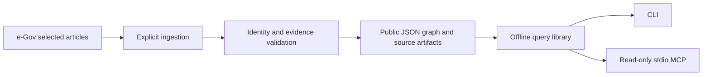

# Architecture

Law Graph separates public legal evidence from the private decisions of its consumers.

Each query process reads one graph snapshot. The offline `merge-graphs` CLI
combines validated snapshots, rejects identity conflicts, and adds reproducible
reference and authority assertions. The original inputs remain unchanged.
Each snapshot contains
law identities, law revisions, provision lineages, provision versions, scoped
concepts, source documents, source content versions, evidence references,
relation assertions, observations, and explicit partial coverage.

A separate case schema and corpus now add topics, issues, cases, typed claims,
source metadata, relations with material differences, and append-only review
records. Case files validate independently and merge deterministically; conflicting
records with the same UUID are rejected. The case sources are not bundled, so
their byte hashes and locators are recorded without claiming offline original-text
verification. See [case graph](case-graph.md).

A third, independent comparative schema connects a shared research issue to
original provision anchors in two explicitly selected jurisdictions. The seed
compares three Japanese/U.S. federal copyright issues. It retains source
language, original/reference-translation status, edition evidence, material
differences, and exclusions without asserting equivalence or choosing applicable
law. Originals are not bundled for this corpus. See [comparative law](comparative-law.md).

The statute source artifacts are selected article responses. They allow evidence validation
without a network call. This small seed deliberately keeps source text available
locally. A future large corpus may distribute content-addressed artifacts
outside Git while preserving the same evidence contract.

## Boundaries

- Public data: law identities, source material, relations, provenance, and coverage.
- Contract products: private links between a specific contract revision and
  specific law-graph node/snapshot identifiers.
- Company legal agents: case facts, interpretation, and decisions.
- Shared agent runtimes: execution and authentication outside this repository.

A relation is a documented assertion with a basis and resolution state, not
a declaration that a provision applies to an individual case.

## Implemented and deferred

Implemented: e-Gov selected-current-article ingestion, reproducible UUIDs,
source hash checks, evidence text checks, containment, a narrow definition
extractor, unresolved delegation candidates, literal search, exact citation
resolution, bounded traversal, offline aggregation, narrow citation/delegation
rules, authority candidates, curated Intent lookup, CLI, and stdio MCP.
Case research adds topic exploration, case search, and case readback with
explicit authority and scope. Comparative research adds one read-only issue
comparison tool, for nine tools in total. Unsupported jurisdictions return
outside coverage.

Deferred: houritsu input, historical interval resolution, automatic lineage
mapping, full citation resolution, comprehensive definition extraction,
authenticated review workflows, exceptions, cross-revision lineage mapping, generated SQLite
indexes, and semantic/vector search.

All seed case summaries and links remain proposed, with no legal-practitioner
review. Review records declare a reviewer and PR URL; this library does not
authenticate identity or credentials and does not turn a record into legal clearance.
Comparative summaries and links are also proposed; structured comparative review
records, foreign case ingestion, and legal-date alignment remain deferred.

No graph database, shared database, HTTP service, or private integration is
required to run the initial version.
