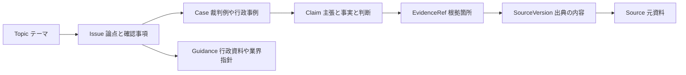

# 事例と論点のグラフ

条文グラフに加え、事業や契約のテーマから調査対象へ入るためのグラフです。
公開された裁判例・行政事例・事業事例を、種類と射程を分けて扱います。



## 初期の3テーマ

| テーマ | 収録した入口 | 限界 |
| --- | --- | --- |
| NFTのランダム販売 | 賭博の検討事項、通常ゲームのガチャ表示事例、業界指針 | NFTの適法性を判断した裁判例は未収録 |
| NDA | 秘密情報の範囲と使用の証拠を扱う裁判例 | 個別契約の文言と事実に依存 |
| 委託取引 | 無償やり直し・支払遅延の行政事例と現行制度の案内 | 旧下請法の事例を現行の取適法の判断へ読み替えない |

## 使い方

```sh
node src/cli.mjs topic --topic NFT
node src/cli.mjs topic --topic NDA
node src/cli.mjs topic --topic 下請法
node src/cli.mjs cases --query 'NFT ガチャ'
node src/cli.mjs cases --query NDA --kind judgment
node src/cli.mjs case --id courts-35471
node src/cli.mjs validate-cases
```

MCPにも `explore_topic`、`search_cases`、`get_case` を追加しています。
事例の検索は、文字列一致と明示したテーマの対応によるもので、意味類似モデルや法的推論エンジンではありません。

## 主張と判断を分ける

Caseのclaimは `party_allegation`、`reported_fact`、
`court_finding`、`regulator_finding`、`outcome`、
`curator_interpretation` に分かれます。原告の主張を裁判所の認定として扱いません。

Caseの種類は `judgment`、`administrative_action`、
`business_example` です。業界ガイドラインはSourceとして論点へ接続し、
判決や行政処分のCaseへ分類しません。

テーマから論点への接続、論点から事例への接続は
`curated_association` です。全ての接続に比較上の相違点を記録します。
関連付けは個別案件に同じ結論が当てはまることを意味しません。

## 時点と出典

Caseの判断日、公表日、原文の取得日を分けます。当時法は
`legal_context.role=at_case_time` とし、現在の適用は
`current_applicability=not_assessed` と返します。控訴・取消訴訟や後続経過は
確認していなければ `later_history=not_checked` です。

SourceとSourceVersionとEvidenceRefにはUUIDがあります。SourceVersionには
取得した原文のバイト列のSHA-256、EvidenceRefにはPDFの頁・節やHTMLの見出しを記録します。
原文はGitに収録せず、元URLと独自の要約を提供します。原文のハッシュを記録したことと、
オフラインで原文・要約の一致を検証したことは異なります。応答でも
`original_bundled=false` と明記します。

当初のe-Gov条文グラフはJSONの原文を同梱して検証しますが、今回の事例グラフは
原文を同梱しない別の証拠形式です。既存の条文スキーマを緩めて両者を混ぜません。

## 協力者が並行して追加する

`data/cases/<topic>/<case-key>.case-graph.json` を1事例単位のまとまりにします。
各ファイルは単独で検証でき、CLI/MCPは既定でディレクトリ内のファイルを統合して読みます。
同じUUIDの異なる内容は、統合時に衝突として拒否します。

レビュー記録は対象UUIDと対象内容のハッシュに結び付け、追記します。修正・撤回は
`supersedes_id` で以前の記録を指します。古い内容へのレビューは残し、
`subject_matches_current=false` として表示します。レビュー記録の存在だけで
GitHub上の本人確認や法的な正しさを認証したことにはしません。

初期データの要約と接続はAI補助の整理案で、全て `proposed` です。
法律実務者のレビューは未実施です。確認者を架空に登録しません。
