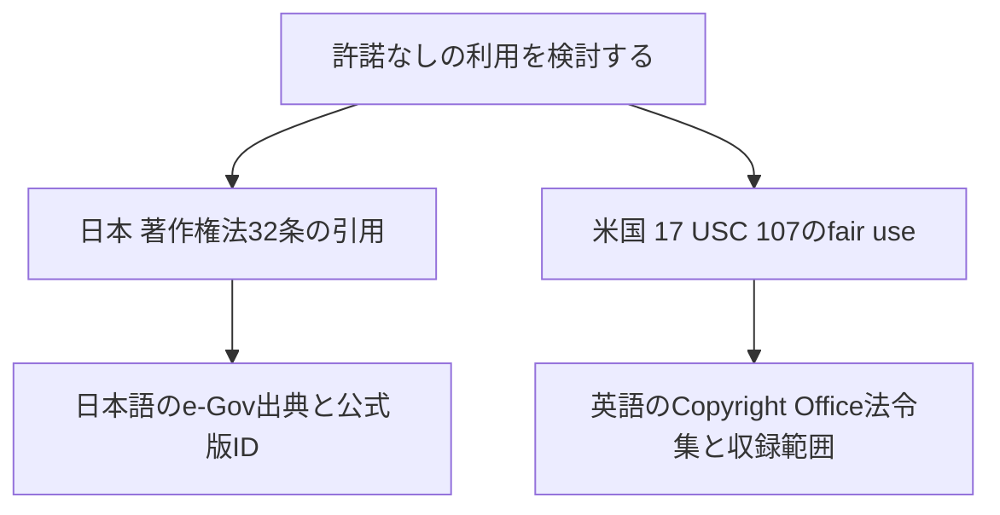

# 法域をまたぐ比較グラフ

日米の著作権を題材に、共通の調査論点から各法域の根拠へ辿る試作です。
同じ制度・効力と認定するリンクは作りません。



## 比較の入口

| 共通の論点 | 日本側 | 米国連邦法側 |
| --- | --- | --- |
| 許諾なしの利用 | 著作権法32条1項 | 17 USC 107 |
| 制作物の著作者 | 著作権法15条 | 17 USC 101・201(b) |
| 譲渡の範囲と形式 | 著作権法61条 | 17 USC 204(a) |

これらは比較のための選択で、互いの制度全体の対応関係を示すものではありません。
例えば日本の引用規定を、米国fair use全体と同一視しません。
権利譲渡の比較も、日本側の留保推定と米国側の書面等の要件という異なる焦点を含みます。

```sh
node src/cli.mjs compare --issue 引用 --jurisdictions JP,US-federal
node src/cli.mjs compare --issue 職務著作 --jurisdictions JP,US-federal
node src/cli.mjs compare --issue 権利譲渡 --jurisdictions JP,US-federal
node src/cli.mjs validate-comparative
```

MCPは `compare_issue` を追加します。法域を2つ明示的に選びます。
未収録の州法・国や論点は `outside_coverage` で返し、連邦法や似た論点に
黙って置き換えません。

## 国と法制度の範囲

Jurisdictionは国コードとnational・federal・stateの区分を持ちます。
初期のキーは `JP` と `US-federal` です。米国の州法、条約、国際私法、
具体的な行為にどの法が適用されるかの判断は未収録・未評価です。

法律のUUIDは法域と公式IDの体系・IDから生成します。日本語で米国法を説明しても
米国法のノードであり、日本法の英訳も日本法のノードです。言語を法域のキーに使いません。
今回の日本の法令UUIDは、既存のe-Gov法令ID規則と一致します。

## 原文と参考訳

Sourceの言語、原文か参考訳か、公的API・公的法令集・参考資料の区分を持ちます。
Anchorの日本語summaryはプロジェクトによる整理案で、法令の翻訳や正文を意味しません。

参考訳を登録する場合は、対応する同一法令・同一箇所・同一版の原文Anchorを指定します。
参考訳を比較のprimary根拠に昇格させることは検証で拒否します。
初期データには参考訳は収録していません。

## 版と証拠

日本側はe-Govの公式版ID `345AC0000000048_20260624_508AC0000000048` で取得した
15・32・61条です。米国側はCopyright Officeの法令集で、
[案内ページ](https://www.copyright.gov/title17/)が2025年12月18日までの改正を収録と記載しています。
2026年11月3日の取得日までに他の改正がないことは、今回の比較では確認していません。

両者を同一日時の現行法として扱わず、`temporal_alignment=not_verified`、
`current_applicability=not_assessed` と返します。
版の案内自体のSourceVersionも保持します。出典の原文は同梱せず、
URL・ハッシュ・版・条項の位置を記録します。

## 関係とレビュー

Comparisonの関係は `compares_issue` だけです。
`equivalence=not_asserted`、相違点、未検討の範囲を必須にします。
判断の転用や、契約準拠法だけから著作権法の適用国を決める処理はありません。

比較と要約はAI補助の整理案で `proposed` のままです。
日本法と米国法それぞれの法律実務者が、根拠と射程を確認することを想定します。
比較データのレビューはPR上で行い、比較グラフの構造化された承認状態はまだ実装していません。

既存の条文取り込みと事例スキーマは引き続き日本向けです。
今回の変更はその収録国を自動的に拡張せず、独立した比較スキーマと読取機能を追加します。
